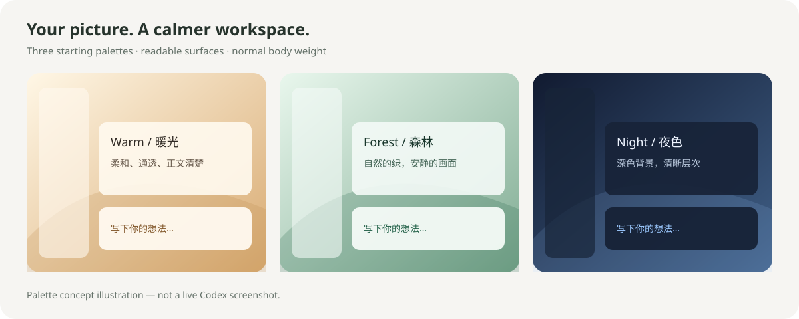

# Codex Background Skill · 把喜欢的画面放进 Codex

**给 Codex 一张图片，或告诉它你喜欢什么风格，让它帮你制作背景、调清楚文字，并按需设置登录后自动恢复。**

[](https://github.com/z060303/codex-background-skill/actions/workflows/validate.yml)
[](LICENSE)



*上图是配色和阅读层次示意，不是真实 Codex 截图。你的图片会成为实际主题的背景。*

## 它能做什么？

- **用自己的图片**：风景、插画、宠物、摄影作品，都可以作为本地背景。
- **从一句话开始**：有绘图工具时请 Codex 生成图片；没有时可用原创渐变，或自己上传图片。
- **把字调清楚**：调整对话卡片、输入框、配色和透明感，正文默认正常字重。
- **照顾不同窗口**：保留原生布局，让 Codex 检查窄窗口、宽窗口和缩放效果。
- **记住喜欢的背景**：可选登录自动恢复，也可选择登录时自动打开 Codex。
- **随时恢复**：先关闭自动恢复，再移除主题，避免“刚还原又变回去”。

适合 **Windows 10/11 + Codex 桌面应用**。需要本机运行工具的权限；网页版聊天不能直接修改电脑上的应用。主题生成需要 Python 3.10+ 与 Pillow；实际显示使用独立开源工具 CodeFace。**这是第三方主题方案，不是修改 Codex 官方默认设置**，主题通常在窗口打开后短暂加载；新版本应用可能需要重新适配。

## 最简单的安装方法：把这段话发给 Codex

```text
请帮我安装这个仓库中的 skills/codex-background：
https://github.com/z060303/codex-background-skill
检查 SKILL.md 和安装脚本后，安装到我的个人 Skills 目录。
这一步只安装 Skill，先不要改当前背景，也不要开启自启动。
```

完成后新建一个任务，输入 `$codex-background`。如果还没识别，重开 Codex 再试。

也可以 [下载 ZIP](https://github.com/z060303/codex-background-skill/archive/refs/heads/main.zip)，解压后在文件夹空白处右键打开终端，运行：

```powershell
powershell -NoProfile -ExecutionPolicy Bypass -File .\install-skill.ps1
```

安装程序默认放到 `~/.codex/skills/codex-background`；设置过 `CODEX_HOME` 的用户会使用该目录。它只复制 Skill，**不会自动改背景或注册开机任务**。也可直接把 `skills/codex-background` 文件夹复制到自己的 Skills 目录。

## 第一次使用：三步就够

### 1. 上传喜欢的图片

在 Codex 对话里上传图片，然后说：

```text
使用 $codex-background，把我上传的图片做成 Codex 背景。
我喜欢通透一些的效果，但对话文字和输入框必须清楚，字体不要很粗。
请先预览，再应用，并检查窗口放大、缩小后的布局。
```

没有图片也可以说：

```text
使用 $codex-background，做一个深蓝色、安静的夜空背景。
如果可以生成图片，请先制作背景图；如果当前没有绘图能力，先做渐变版本。
```

Codex 会检查依赖。首次缺少 CodeFace 时，可使用本仓库 [Release](https://github.com/z060303/codex-background-skill/releases/tag/v1.0.0) 提供的校验归档；详见 [依赖来源](THIRD_PARTY_NOTICES.md)。下载工具先核对 SHA-256，再解压，不会自动执行下载的程序。

### 2. 像聊天一样调整

```text
让背景更明显一点，但保留对话内容下面的浅色底。
```

```text
正文改成正常字重，去掉文字描边。输入框再清楚一点。
```

```text
窗口变窄时看着挤，帮我检查 80%、100%、125%、150% 缩放。
```

### 3. 满意后再设置自动恢复

只希望打开 Codex 后恢复背景：

```text
使用 $codex-background，保存这套主题，开启登录后的后台自动恢复。
不要在开机时主动打开 Codex。给我一个带背景的启动快捷方式。
```

希望登录 Windows 时就打开 Codex：

```text
使用 $codex-background，把这套主题设为登录后自动加载，
并在登录 Windows 时自动打开 Codex。验证实际后台任务能读取主题文件。
```

**首次普通启动如果没有主题连接端口**，请先保存工作并关闭 Codex，再打开工具生成的 `Codex with background.lnk`。安装目录通常是 `%LOCALAPPDATA%\Programs\CodexBackgroundSkill`。以后可把这个快捷方式放到桌面。工具不会强制关闭正在运行的 Codex。

## 不想用了怎么办？

直接说：

```text
使用 $codex-background，关闭这个 Skill 的自启动和后台恢复，恢复 Codex 原来的界面。
```

也可以双击安装目录内的 `Restore native appearance.lnk`。这会停用本工具自己的计划任务，再调用 CodeFace `--restore`。如果电脑上另有旧背景脚本，需要另外识别并停用，不能只恢复界面却让旧脚本继续重刷。

## 常见问题

| 遇到的情况 | 怎么处理 |
|---|---|
| 安装 Skill 后背景没有马上变化 | Skill 是操作指南；还需要在对话里调用它制作并应用主题。 |
| 重开 Codex 又没背景 | 用带背景的快捷方式启动，并让 Codex 执行 Diagnose。普通启动入口不一定开放主题连接端口。 |
| 为什么不能保证第一帧就是背景？ | 这是在桌面应用启动后加载的外观层，需要等待窗口和连接准备好。 |
| 任务显示运行中，但还是白色 | 要检查真实页面和健康报告，运行状态本身不能证明成功。 |
| 后台任务找不到文件 | 可能是路径、权限或文件加密问题；工具使用独立目录，不会解密整个 AppData。 |
| 恢复后背景又回来了 | 可能还有旧监控脚本；先停监控再恢复。 |
| Codex 更新后失效 | 运行诊断并适配新版本；工具不会通过反复重启来碰运气。 |
| 能用于 macOS / Linux 吗？ | 主题设计思路可复用；附带启动脚本只支持 Windows。其他平台需另行适配，未宣称测试通过。 |

## 文件说明和手动操作

- [Skill 入口](skills/codex-background/SKILL.md)：供 Codex 阅读的完整操作流程。
- [Windows 操作参考](skills/codex-background/references/windows.md)：下载、制作、应用、自启动、恢复的具体命令。
- [设计与验收](skills/codex-background/references/design.md)：透明度、字重、主题格式与缩放检查。
- [故障排查](skills/codex-background/references/troubleshooting.md)：重启丢背景等问题的检查顺序。
- [兼容性与测试范围](docs/TESTING.md)：哪些已测，哪些仍需用户实际验证。
- [CodeFace 依赖来源与许可证](THIRD_PARTY_NOTICES.md)。

开发者验证：

```powershell
python -m pip install -r requirements.txt
python -m unittest discover -s tests -p "test_*.py" -v
powershell -NoProfile -ExecutionPolicy Bypass -File tests/test_runtime.ps1
```

## 致谢

主题显示依赖 [CodeFace](https://github.com/sundy-li/CodeFace)，遵循其 MIT 许可；本项目整理了图片定制、阅读优化与 Windows 持久化流程。Skill 结构参考 [OpenAI Skills 文档](https://developers.openai.com/plugins/concepts/skills)。示例渐变为本项目原创；没有包含个人聊天截图、账号资料或个人壁纸。
